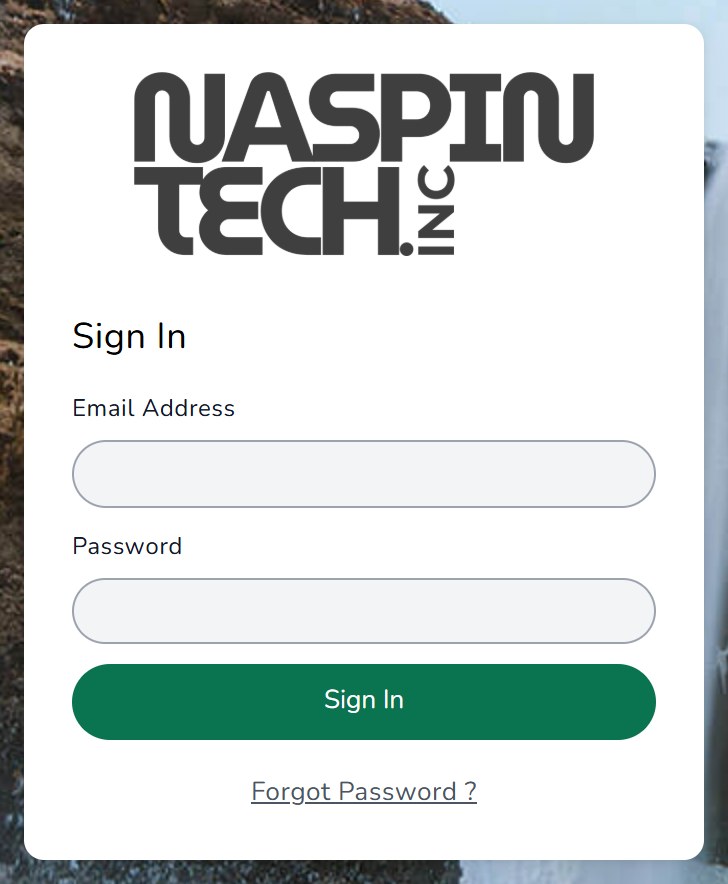
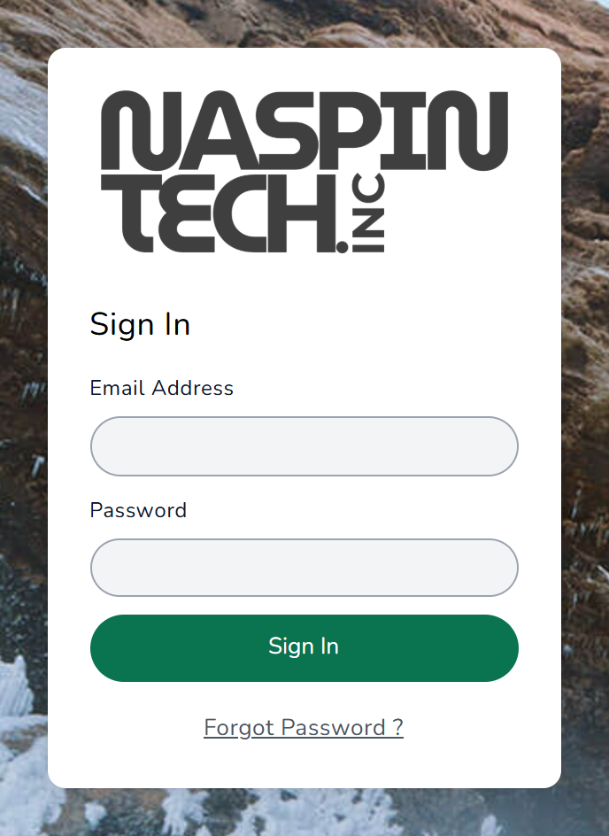
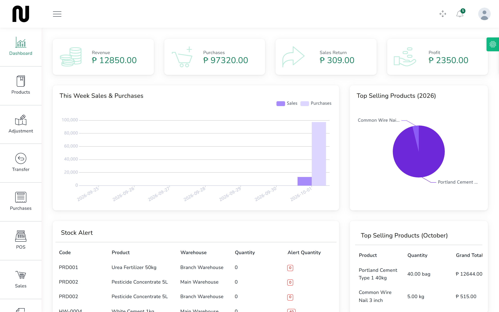
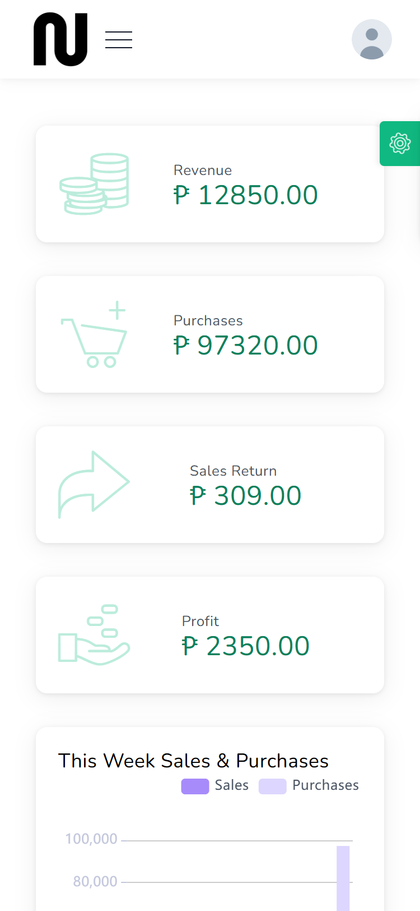

# Getting started

Everything in CIMS happens after you sign in. This page covers signing in, finding your way
around, and the one thing to check before anyone sells anything.

## Signing in

1. Open your browser and go to the shop's CIMS address.
   On the counter PC this is usually already saved as the home page.
   

2. Type your email in **Email Address** and your password in **Password**.

3. Press **Sign In**.
   The **Dashboard** opens. If it does not, see
   [When something goes wrong](when-something-goes-wrong.md).

The same two boxes, stacked, are what a phone shows:

There is a **Forgot Password ?** link under the button. It emails you a reset link — but the
shop's email settings have never been filled in, so no mail can go out. Press it and, after as
much as half a minute, the screen turns red: **The reset email could not be sent. Check the
SMTP settings under Settings, then System Settings.** Nothing was sent and nothing is coming.

Until those settings are filled in, ask whoever looks after the shop's accounts to set you a
new password instead. See [Add a staff account](18-add-a-staff-account.md).

Nobody can see the shop's figures without signing in, so never leave the counter PC signed in
and unattended.

## Finding your way around

The dark strip down the left is the menu. The entries you will use most are near the top.

| Menu entry | What it is for |
|---|---|
| **Dashboard** | The day at a glance, plus a **Stock Alert** list of what is running out |
| **Products** | The catalogue: every item the shop sells |
| **Adjustment** | Taking stock off the shelf for damage or loss |
| **Transfer** | Moving stock between Main Warehouse and Branch Warehouse |
| **Purchases** | Ordering from suppliers |
| **POS** | The counter: ringing up sales |
| **Sales** | Every invoice the shop has issued |

Lower down the menu are **Quotations**, **People** (customers, suppliers and staff),
**Reports** and **Settings**.

On a phone the menu is hidden. Press the three lines at the top left to open it.

## Before anyone sells: check the warehouse

The shop has two places stock can sit: **Main Warehouse** and **Branch Warehouse**. Almost every
screen asks which one you mean, and the answer changes what you see.

This matters more than it sounds. If the counter is set to the wrong warehouse, it will sell
stock the shop does not have in front of it, and the branch will be short without anyone
noticing until a count.

At the counter, the warehouse is the second box down on the **POS** screen. Set it once at the
start of the day.

## A note about who can see what

Right now the shop has a single sign-in with the **Owner** role, which can reach every screen,
including the money and the settings.

If you want the counter staff to see only the till, that is possible — CIMS controls it per
person — but the accounts have to be created first. See
[Add a staff account](18-add-a-staff-account.md).

## Where to go next

If you are on the counter, read [Open the till](02-open-the-till.md) next, then
[Ring up a sale](03-ring-up-a-sale.md).

If you are in the stockroom, start at [Book in a delivery](09-book-in-a-delivery.md).

If you run the shop, [What to reorder](14-what-to-reorder.md) and
[The day's takings](16-the-days-takings.md) are the two you will open most.
