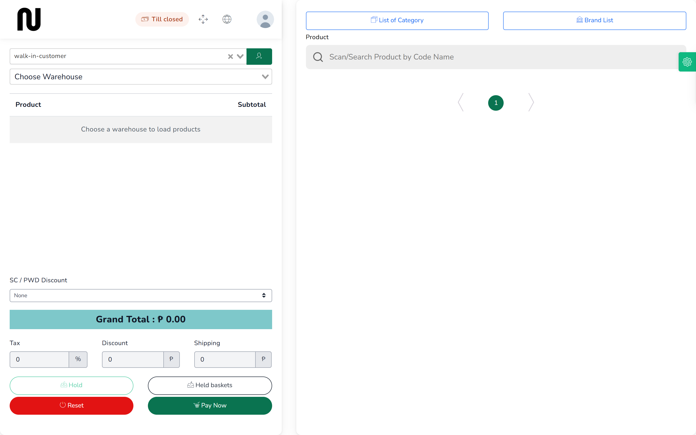
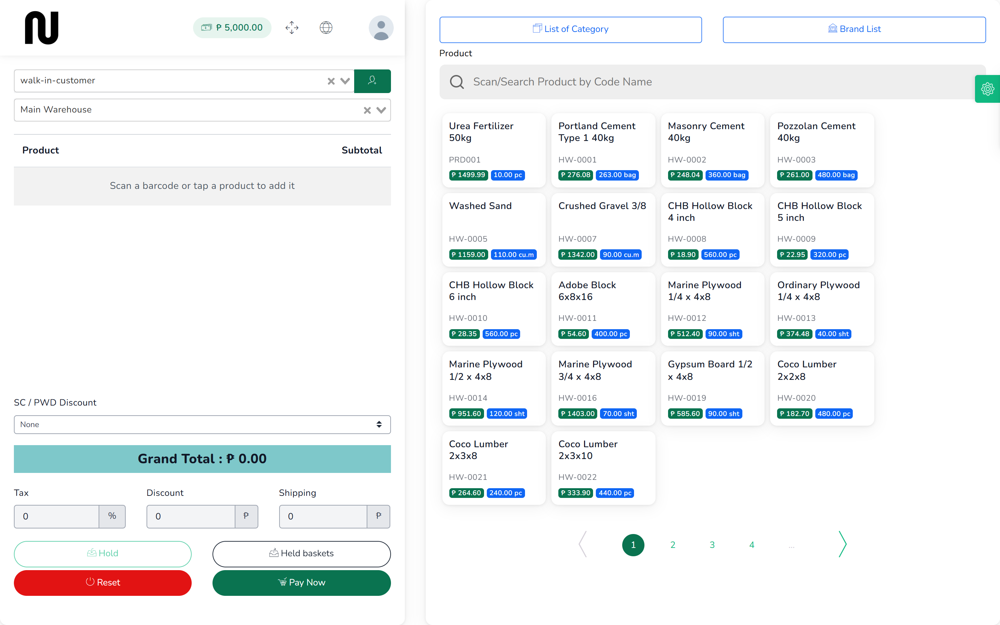

# Open the till

At the start of the day you tell CIMS how much cash is in the drawer. From then on it keeps
count, so that at closing time it can tell you what should be there. This takes about a minute.

**Before you start:** count the float — the cash you are starting the drawer with.

## Steps

1. From the menu, choose **POS**.
   The counter screen opens. At the top left it says **Till closed**.
   

2. In the second box down, choose the warehouse you are selling from — normally
   **Main Warehouse**.
   The products appear on the right, each showing its code, price and how much is in stock.
   This takes a few seconds.
   

3. Press **Till closed** at the top left.
   A **Till session** box opens saying you have no drawer open at this warehouse.

4. Press **Open till**.

5. Leave **Terminal** as **MAIN** unless the shop has more than one counter.
   If it has two, give each one its own name so the drawers can be told apart.

6. Type the cash you counted into **Opening float**.

7. Press **Open till**.
   The label at the top left changes from **Till closed** to the amount in the drawer.

Once the drawer is open you can sell. See [Ring up a sale](03-ring-up-a-sale.md).

## What happens next

CIMS now adds every cash sale to the drawer and takes off every cash refund. You can check the
running figure at any time by pressing the amount at the top left.

**Cash in** and **Cash out** are for money that moves without a sale — paying a delivery driver
out of the drawer, or adding change from the safe. Use them, or the drawer will not balance at
closing time.

**Print X-reading** shows where the shift stands without closing it. It is safe to press at any
time and changes nothing.

## If it does not work

| You see | It means | Do this |
|---|---|---|
| **Choose Warehouse** | you pressed before choosing a warehouse | choose the warehouse in the second box, then try again |
| **This drawer already has a session open. Close it before opening another.** | this terminal already has an open drawer | press the amount at the top left to see it; close it before opening a new one |
| **Open the till before selling. No drawer is open for you at this warehouse.** | you tried to sell with no drawer open | open the till as above |

One drawer belongs to one person at one terminal. If a colleague opened it, they have to close
it — their name is on the shift.
