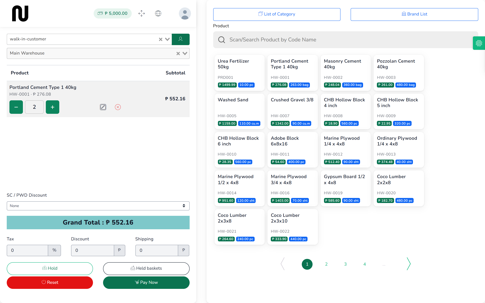
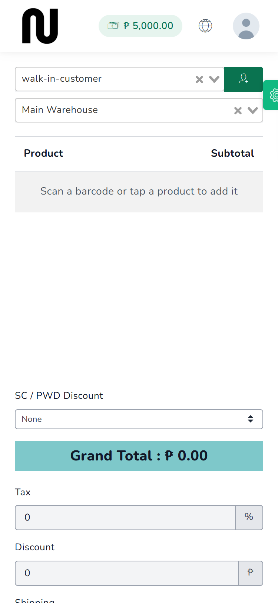
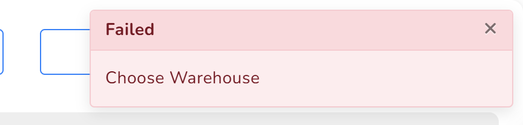

# Ring up a sale

A customer brings goods to the counter. You find each item, take the money, and hand them a
receipt. Most sales take under a minute.

**Before you start:** the till has to be open. See [Open the till](02-open-the-till.md).

## Steps

1. From the menu, choose **POS**, and check the warehouse box reads the one you are selling
   from.

2. Find each item and press it to add it to the basket.
   You can scan the barcode, type the code or name into **Scan/Search Product by Code Name**,
   or press the item in the grid. **List of Category** and **Brand List** narrow the grid.

3. Set the quantity with **−** and **+**, or press the quantity box and type it.
   The line total and **Grand Total** update as you go.
   

   The price shown already includes VAT. What the customer pays is the price on the shelf.

4. If the customer is a senior citizen or a person with disability, choose the right entry in
   **SC / PWD Discount** and enter their ID when asked.
   The discount and the VAT exemption are worked out for you.

5. Press **Pay Now**.
   The **Create Payment** box opens with the amount already filled in.

6. Type what the customer handed you into **Received Amount**.
   **Change** shows what to give back.

7. Choose how they paid in **Payment choice** — **Cash**, **GCash** and the others the shop
   accepts.

8. If they are paying two ways — some cash, the rest by GCash — turn on **Split the payment**
   and enter each amount. The parts must add up to the total.

9. Press **Submit**.
   The receipt appears on screen with the invoice number at the bottom, and the drawer figure
   at the top left goes up by the cash taken.

10. Press **Print** to print the receipt, or close the box to carry on.

## On a phone

The counter screen is about one and a half screens tall on a phone, and everything is in one
column instead of two. The order going down is: the customer, the warehouse, the basket, the
totals, then **Hold**, **Held baskets**, **Reset** and **Pay Now**.

**The products are below Pay Now, not above it.** Scroll past the buttons to reach the search
box and the product grid. This catches everyone the first time — the screen looks finished at
**Pay Now**, so it does not look as though there is anything further down.

The drawer figure at the top shows **Till closed** in red when no drawer is open, and the float
in green when one is.

## What happens next

The stock comes off the shelf straight away, so the next customer sees the reduced figure.

The invoice is on the **Sales** list, and the sale is counted in the drawer for whoever closes
the till tonight.

The receipt shows **VATable Sales**, **12% VAT**, **VAT-Exempt Sales** and **Zero-Rated Sales**
separately. That split is what the BIR expects to see, and it is worked out from each product's
own setting rather than typed in.

## If it does not work

| You see | It means | Do this |
|---|---|---|
| **Choose Warehouse** | no warehouse is chosen | choose one in the second box down |
| **Open the till before selling. No drawer is open for you at this warehouse.** | no drawer is open | see [Open the till](02-open-the-till.md) |
| **Insufficient stock for the selected product and warehouse.** | this warehouse does not hold that many | check the stock figure on the item, or sell from the other warehouse |
| **The amount paid cannot be more than the order total of {amount}.** | the tendered amount is higher than the sale | enter what the customer owes; put the cash they handed over in **Received Amount** instead |
| **This sale would take {customer} to {amount}, over their credit limit of {limit}.** | a credit customer is over their limit | take a payment on their account first, or raise the limit on their customer record |
