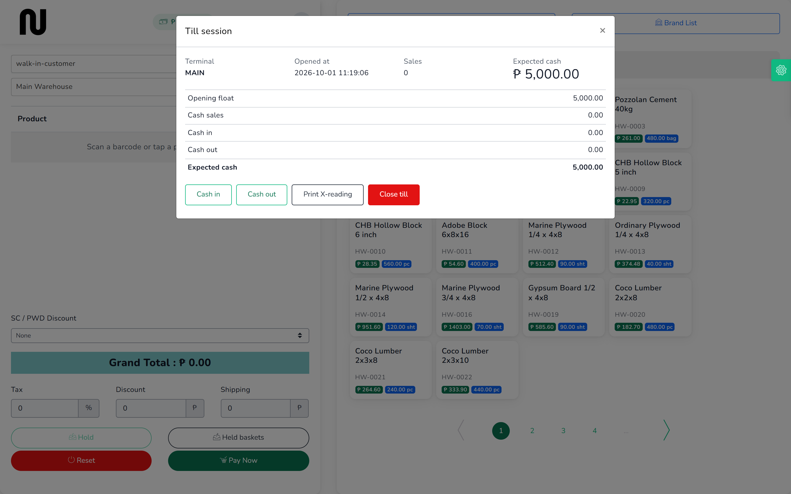

# Close the till

At the end of the shift you count the drawer and tell CIMS what you found. It compares that
with what it expected and records the difference. This takes a couple of minutes.

**Before you start:** count the cash in the drawer, including the float you started with.

## Steps

1. From the menu, choose **POS**, and check the warehouse box reads the one you have been
   selling from.

2. Press the amount at the top left.
   The **Till session** box opens showing where the shift stands.
   

3. Read **Expected cash**. That is what should be in the drawer: the float, plus cash sales,
   plus anything added with **Cash in**, less anything taken with **Cash out**, less cash
   refunds.

4. Press **Close till**.

5. Type what you actually counted into **Counted cash**.
   The box works out the difference as you type and shows it beside **Expected cash**.

6. If there is a difference, say why in **Notes**. "₱50 short, no obvious cause" is a perfectly
   good note.

7. Press **Close till**.
   The label at the top left goes back to **Till closed**.

## What happens next

The shift is now a **Z-reading** — the end-of-day record. It holds the opening float, the cash
counted, the difference, the number of sales, the first and last invoice numbers, the VAT split
and any voids.

You cannot close the same shift twice, and you cannot reopen it. If you counted wrong, tell
whoever runs the shop rather than trying to correct it yourself — the Z-reading is the record
the books are built on.

To sell again, open a new drawer. See [Open the till](02-open-the-till.md).

Past shifts are under **Reports** → **Till Sessions**. See
[The day's takings](16-the-days-takings.md).

## About shortfalls

A difference is recorded, not hidden. Short means less cash than expected; over means more.

Both are worth looking at. The usual causes are change given wrong, a cash payment rung up as
GCash, or money taken from the drawer without using **Cash out**.

A drawer that balances exactly every single day is worth a second look, not praise — it usually
means somebody is typing the expected figure into **Counted cash** instead of counting.

## If it does not work

| You see | It means | Do this |
|---|---|---|
| **This field is required** | **Counted cash** is blank | type what you counted, even if it is 0 |
| the figure will not accept a negative | a counted drawer cannot be less than nothing | count again; if the drawer is genuinely empty, enter 0 |
| **That shift has already been counted down.** | the drawer is already closed | check **Reports** → **Till Sessions** for the Z-reading |
