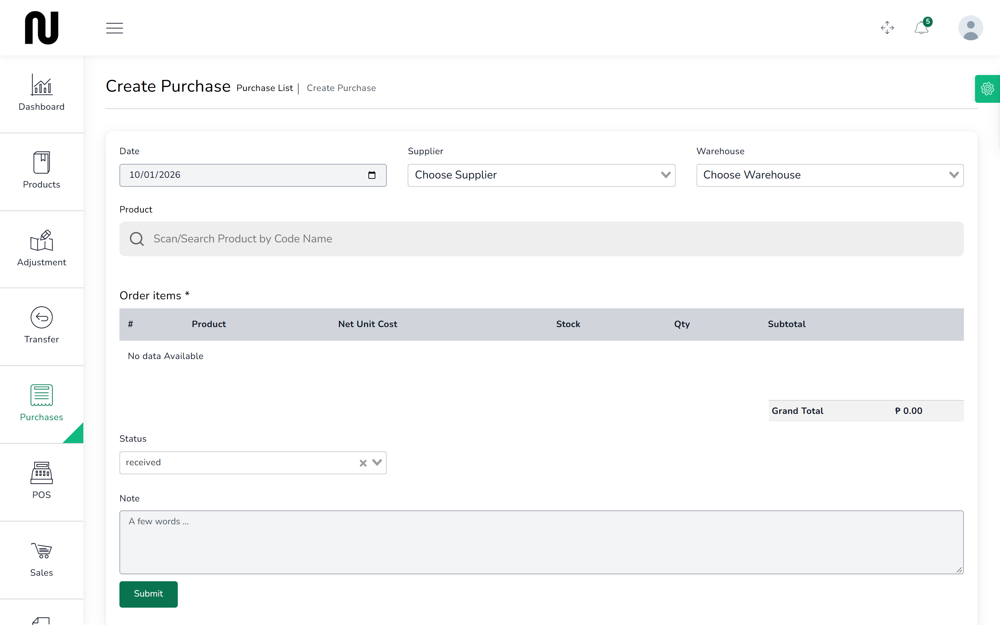

# Order stock

You raise a purchase order so the supplier knows what to send and the shop has a record of what
is coming. Ordering does not change your stock — nothing moves until the delivery arrives.

**Before you start:** the supplier must be on file. **People** → **Suppliers** lists them, and
has a button to add one.

## Steps

1. From the menu, choose **Purchases**, then **Create Purchase**.
   

2. Set the **Date**, choose the **Supplier**, and choose the **Warehouse** the goods will be
   delivered to.

3. Find each product and add it, the same way as at the counter — scan, type the code or name,
   or pick it from the list.

4. For each line, enter the **Quantity** and the **Unit Cost** the supplier is charging you.
   This is the cost price, not the shelf price.

5. Leave **Status** at **ordered**, which is what it already shows.
   Choosing **received** before the goods arrive puts stock on the shelf that is still on
   the lorry.

6. Press **Submit**.
   The order appears on the **Purchases** list with a reference starting **PR_**.

## What happens next

**Nothing reaches the shelf yet.** That is correct — an order is not a delivery.

The order now needs approving before anything can be booked in against it. See
[Approve an order](08-approve-an-order.md).

When the goods arrive, see [Book in a delivery](09-book-in-a-delivery.md).

## About the cost you enter

The **Unit Cost** matters more than it looks. When the goods are booked in, CIMS works out a new
average cost for that product across everything you hold — what you paid before and what you
have just paid, weighted by quantity.

That average is what every margin and every stock valuation is based on afterwards. Entering the
shelf price here instead of what the supplier charged will quietly make the shop look
unprofitable.

## If it does not work

| You see | It means | Do this |
|---|---|---|
| **This field is required** | supplier, warehouse or a quantity is blank | fill the highlighted boxes |
| a product cannot be found | it is not in the catalogue, or has no record at that warehouse | see [Add a product](17-add-a-product.md) |
| the total looks wrong | CIMS recalculates the total itself from the quantities and costs | check each line's quantity and unit cost; the total follows them |
