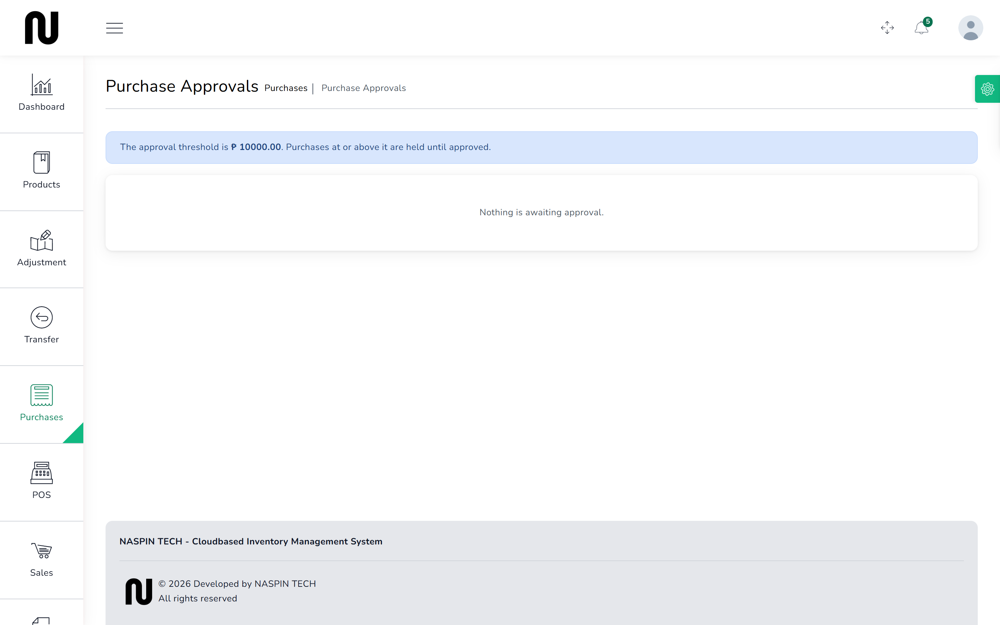

# Approve an order

A purchase order has to be signed off before any goods can be booked in against it. This is the
shop's check on what is being bought and at what price.

**Before you start:** the order must already be raised. See [Order stock](07-order-stock.md).

## Steps

1. From the menu, choose **Purchases**, then **Approvals**.
   Every order waiting for sign-off is listed.
   

2. Check the order: the supplier, the quantities, and the unit costs.
   This is the moment to catch a price that has gone up without anyone agreeing it.

3. Approve it, or reject it with a reason.

4. The order moves off the approvals list.
   CIMS records who approved it and when.

## What happens next

The stockroom can now book in deliveries against this order. See
[Book in a delivery](09-book-in-a-delivery.md).

Until an order is approved, trying to receive against it is refused outright and **no stock
moves**. That is the control working, not a fault.

A rejected order cannot be received against at all.

## If it does not work

| You see | It means | Do this |
|---|---|---|
| **This purchase is awaiting approval and cannot be received yet.** | somebody tried to book in a delivery first | approve the order here, then book the delivery in |
| **This purchase was rejected and cannot be received.** | the order was turned down | raise a new order if the goods are genuinely wanted |
| **This purchase is not awaiting approval (it is {status}).** | it has already been approved or rejected | no action needed; check the status on the **Purchases** list |
| the approvals list is empty | nothing is waiting | that is normal — orders only appear here between being raised and being signed off |
