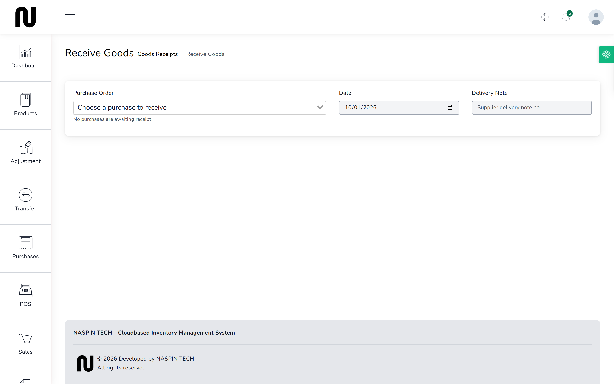
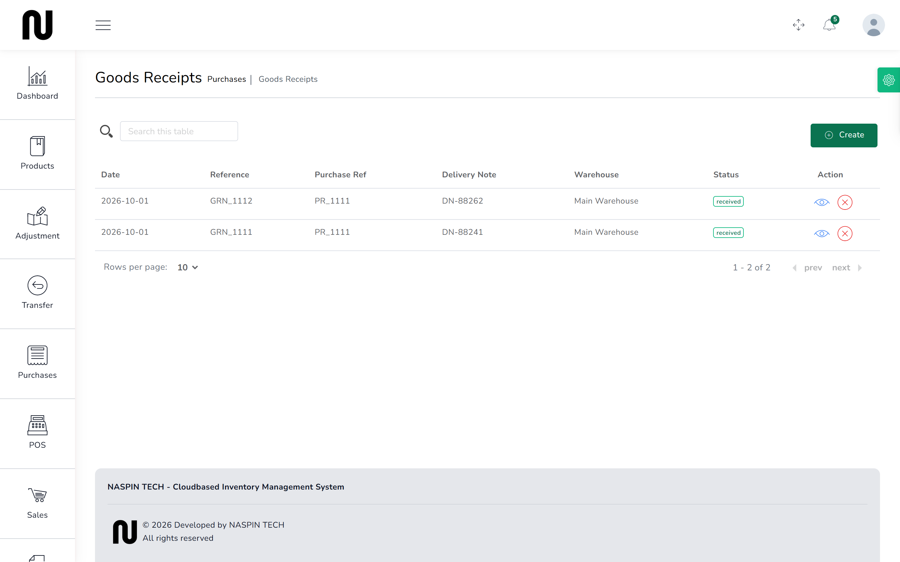

# Book in a delivery

The lorry arrives. You check what came off it against the order, book in what is good, and
reject what is damaged. Only what you book in reaches the shelf.

**Before you start:** the order must be raised and approved. See
[Approve an order](08-approve-an-order.md).

## Steps

1. From the menu, choose **Goods Receipts**, then **Create Goods Receipt**.
   

2. Choose the order you are receiving against. Only approved orders with something still
   outstanding appear.
   The lines fill in with what is still due.

3. Set the **Date** and, if the driver gave you one, type the delivery note number into
   **Delivery note**.

4. For each line, enter how many arrived in good condition.

5. If anything is damaged, put that number in the rejected column rather than reducing the
   received figure.
   **Rejected goods do not reach the shelf.** The difference is the point: the order still shows
   what was ordered, the receipt shows what was accepted, and the gap is visible.

6. Add a note about anything worth remembering. "Five bags torn, returned on the truck" takes
   five seconds and settles an argument a month later.

7. Press **Submit**.
   The receipt gets a reference starting **GRN_**.

## What happens next

The accepted goods are on the shelf immediately, and the cost is recalculated.

If you bought at a different price from last time, the average cost of that product moves — see
[Order stock](07-order-stock.md) for why that matters.

The order stays open until everything ordered has been received. A part delivery is normal:
book in what came, and book in the rest when it arrives.

If the rest is never coming — the supplier wrote it off, or discontinued the line — see
[Close a short order](10-close-a-short-order.md). Leaving it open means the shop keeps counting
stock that will never arrive.

## If it does not work

| You see | It means | Do this |
|---|---|---|
| **This purchase is awaiting approval and cannot be received yet.** | the order has not been signed off | see [Approve an order](08-approve-an-order.md) |
| **This purchase was rejected and cannot be received.** | the order was turned down | raise a new order |
| **This order was closed short on {date} ({reason}). Raise a new order for anything that still arrives.** | somebody closed the order short and the goods turned up anyway | raise a new order for what arrived; do not reopen the closed one |
| the order is not in the list | it is fully received, rejected, or closed short | check its status on the **Purchases** list |
| you booked in too many | the receipt cannot exceed what was ordered | book in what actually arrived; if the supplier sent extra, raise a second order for it |
