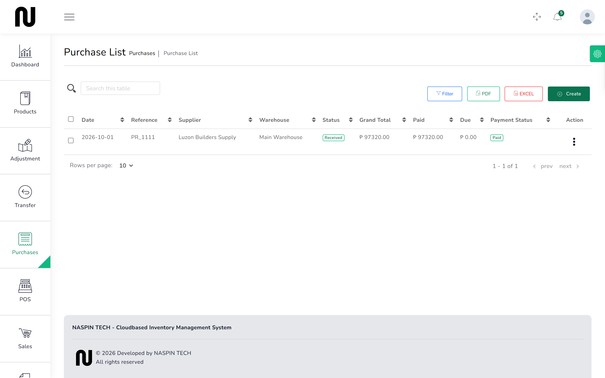

# Close a short order

Part of an order is never going to arrive. The supplier wrote off the damaged bags, or
discontinued the line, or simply stopped answering. Closing the order short stops the shop
waiting for goods that are not coming.

**Before you start:** be sure the balance really is not coming. If it is merely late, leave the
order open — a late delivery can still be booked in against an open order, but not against a
closed one.

## Steps

1. From the menu, choose **Purchases**.
   

2. Find the order. It will still read as not fully received.

3. Close it short.

4. Type why. This is required, and it is the whole point of the record: "Five bags written off
   by the supplier, no reship" tells the next person what happened. "Closed" tells them nothing.

5. Confirm.
   The order drops off the list of deliveries still expected.

## What happens next

**No stock moves and nothing is rewritten.** If 195 of 200 bags arrived, the order still says
195 of 200 arrived, because that is what happened. What changes is that somebody has recorded,
with a reason and their name, that the remaining five are not coming.

The order no longer appears when you go to book in a delivery, and it no longer counts toward
goods on their way.

Once closed:

- It cannot be closed again.
- Nothing more can be received against it.
- Deleting an earlier receipt will not quietly reopen it.

If the goods do turn up afterwards, raise a new order for them. That keeps the record honest:
the first order was closed because the stock was not coming, and the second exists because it
did.

## If it does not work

| You see | It means | Do this |
|---|---|---|
| **This field is required** | you did not say why | type a reason; an order that vanished without one is worse than one left open |
| **Everything on this order has been received, so there is nothing to close.** | the order is already complete | no action needed |
| **This order was already closed short on {date}.** | somebody closed it already | check the **Purchases** list for its status and the reason recorded |
