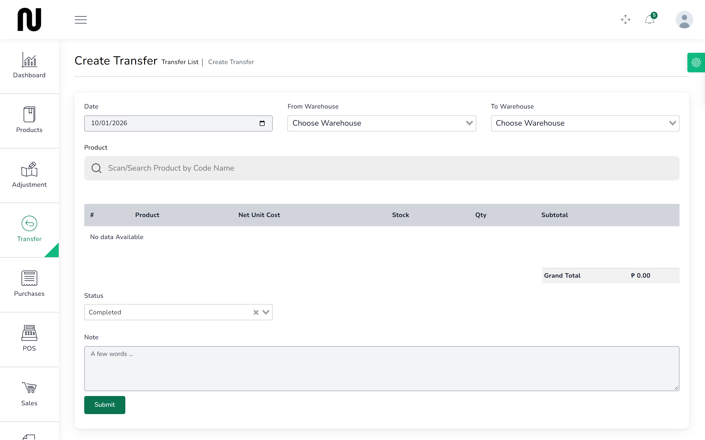
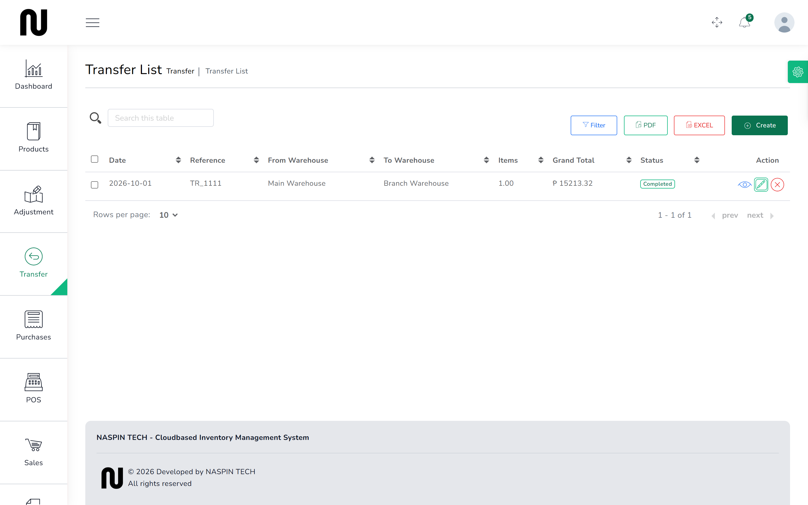

# Move stock to the branch

The branch has run out of cement and Main has plenty. A transfer takes stock off one warehouse
and puts it on the other.

**Before you start:** check the sending warehouse actually holds what you are moving. The
quantity shows beside each product as you add it.

## Steps

1. From the menu, choose **Transfer**, then **Create Transfer**.
   

2. Set the **Date**.

3. Choose **From Warehouse** — where the stock is now.

4. Choose **To Warehouse** — where it is going.
   These must be different.

5. Find each product and add it. The stock figure shown is for the **sending** warehouse.

6. Enter the quantity for each line.

7. Set the status to the one meaning the goods have actually moved, not merely been planned.

8. Press **Submit**.
   The transfer appears on the list with a reference starting **TR_**.

## What happens next

The sending warehouse goes down and the receiving one goes up, by the same amount, at the same
moment. The shop owns exactly as much as it did before — stock has moved, not changed.

Both halves are recorded against the same transfer reference, so a movement report shows the two
sides as one event rather than an unexplained loss at one branch and an unexplained gain at the
other.

You can move a product to a branch that has never stocked it. The branch simply starts holding
it from that moment.

## If it does not work

| You see | It means | Do this |
|---|---|---|
| **This field is required** | a warehouse or quantity is blank | fill the highlighted boxes |
| **Insufficient stock for the selected product and warehouse.** | the sending warehouse does not hold that many | reduce the quantity, or send from the other warehouse |
| the product shows 0 in stock | the sending warehouse has none | you cannot send what is not there; order it in instead |
| both warehouse boxes are the same | a transfer needs two different places | change one of them |

## A word about counting

After a transfer, each branch's figures change. If somebody is part-way through a stock count at
either branch, finish the count first — otherwise the count sheet was taken before the stock
moved and the variance it reports will be the transfer, not a real discrepancy.
