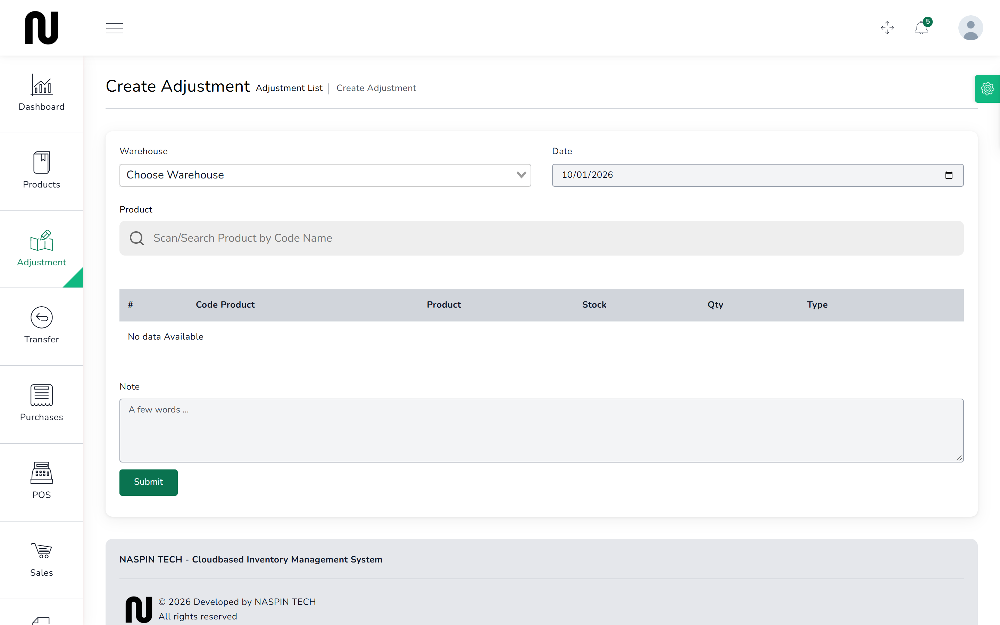
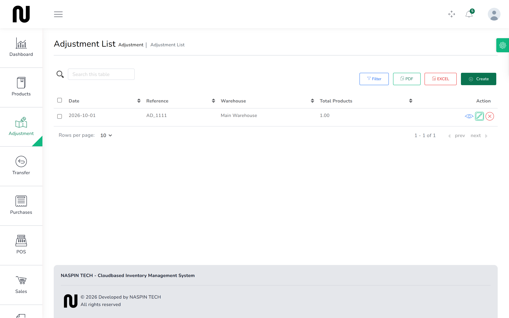
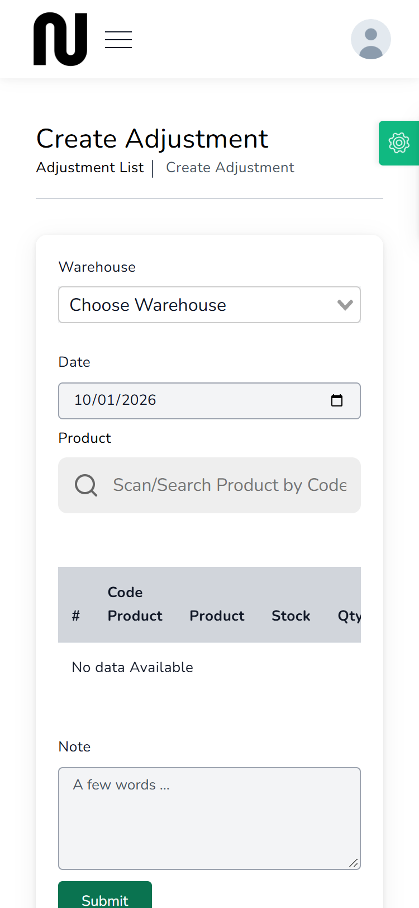
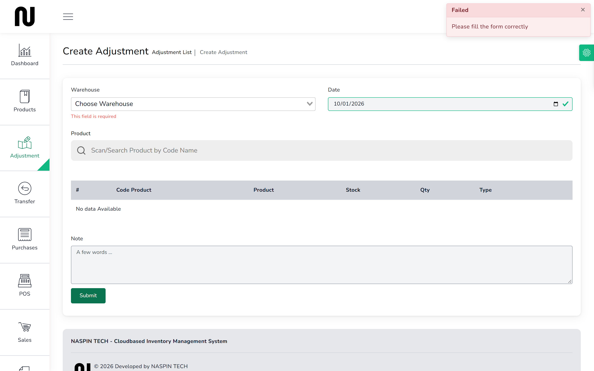

# Write off damage

Cement has set in the bag, nails have rusted, a sheet of plywood was dropped. The stock is gone
but nobody bought it, so it has to come off the shelf deliberately.

An adjustment can also add stock — found goods, or correcting an entry made wrong.

**Before you start:** if you are correcting a whole shelf rather than one item, a stock count is
the better tool. See [Count the shelf](13-count-the-shelf.md).

## Steps

1. From the menu, choose **Adjustment**, then **Create Adjustment**.
   

2. Choose the **Warehouse** the stock is in.
   Nothing can be added until you do — the product list is drawn from that warehouse.

3. Set the **Date**.

4. Find the product by name or code and press it to add a line.
   The **Stock** column shows what that warehouse currently holds.

5. Enter the **Qty** — how many are affected, not what should be left.

6. Set **Type**:
   - **Subtraction** takes stock off, for damage, loss or theft.
   - **Addition** puts stock on, for goods found or an earlier mistake.

7. Type what happened in **Note**. "Rust damage found in the yard" is enough, and it is what
   somebody will read when they ask why the figure changed.

8. Press **Submit**.
   The adjustment gets a reference starting **AD_**.

## What happens next

The shelf changes immediately, and the movement is recorded against the adjustment reference —
so anyone asking "why is this figure different?" can trace it back to this document and your
note.

Written-off stock still cost the shop money. It does not come back as a refund from anyone, and
it reduces what the stock on hand is worth. Regular write-offs of the same product are worth
raising with whoever runs the shop — it usually means a storage problem rather than an
accounting one.

On a phone the screen stacks into one column and works the same way.

## If it does not work

| You see | It means | Do this |
|---|---|---|
| **This field is required** | warehouse, quantity or type is blank | fill the highlighted boxes |
| nothing found when searching a product | no warehouse chosen, or that warehouse has no record of it | choose the warehouse first; then check the product exists |
| a quantity of 0 is refused | an adjustment of nothing is not an adjustment | enter the number actually affected |
| **Insufficient stock for the selected product and warehouse.** | you are subtracting more than the shelf holds | check the **Stock** column and enter no more than that |
