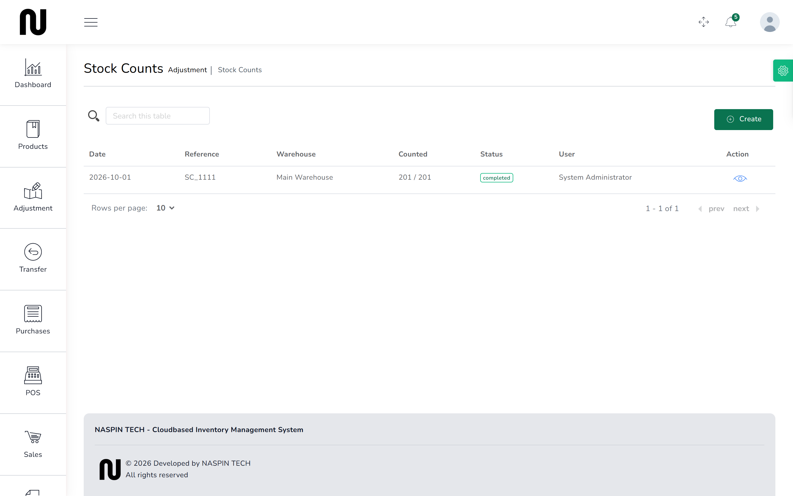

# Count the shelf

A stock count is where you walk the shelves, write down what is actually there, and make the
system agree with reality. It is the only thing that catches slow losses — miscounts at the
counter, breakage nobody reported, short deliveries nobody noticed.

**Before you start:** pick a quiet time. Stock that moves during a count makes the figures
argue with each other.

## Steps

1. From the menu, choose **Stock Counts**, then start a new count.
   

2. Choose the **Warehouse** you are counting and set the **Date**.

3. Optionally choose a **Category** to count one department at a time — fasteners today,
   paint tomorrow. A whole-shop count of 200 lines in one go rarely gets finished.

4. Submit to open the count.
   It is created as a **draft**, and a sheet is produced listing every product held at that
   warehouse with what the system believes is there.

5. Walk the shelves and enter what you actually count against each line.
   Nothing changes on the shelf while you do this — a draft count is just a list.

6. Save as you go. You can leave a draft and come back to it.

7. When the sheet is complete, complete the count.
   Every line where your figure differs is posted, and the shelf becomes what you counted.

## What happens next

The stock figures now match what you found. Each correction is recorded against the count
reference, so the difference is traceable rather than appearing from nowhere.

Lines you counted correctly are left alone — only differences move.

A completed count cannot be edited or completed again. If you find you counted wrong, make an
adjustment for the difference and say why. See [Write off damage](12-write-off-damage.md).

## Reading the result

A count that finds nothing wrong across 200 lines is unusual. A few units out on fast-moving
small items — nails by the kilo, screws by the box — is normal.

What is worth investigating is a large difference on a high-value line, or the same product
coming up short every count. That is a pattern, not an accident.

## If it does not work

| You see | It means | Do this |
|---|---|---|
| **This field is required** | warehouse or date is blank | fill the highlighted boxes |
| **This count is {status} and can no longer be edited.** | the count is finished or cancelled | start a new count, or make an adjustment for the difference |
| **This count is already completed.** | somebody completed it already | check the stock figures; the corrections have been posted |
| the sheet is missing products | the sheet only lists what that warehouse holds a record of | check the warehouse, and the category filter if you used one |
| the figures changed while counting | stock moved during the count | finish the count, then check for transfers or sales made in the meantime |
