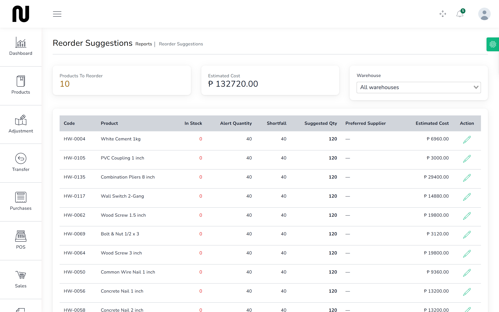
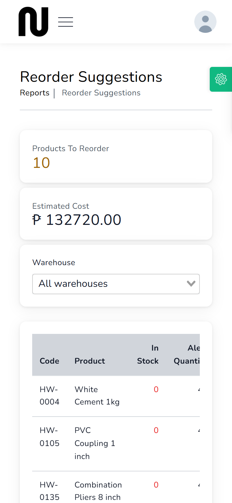
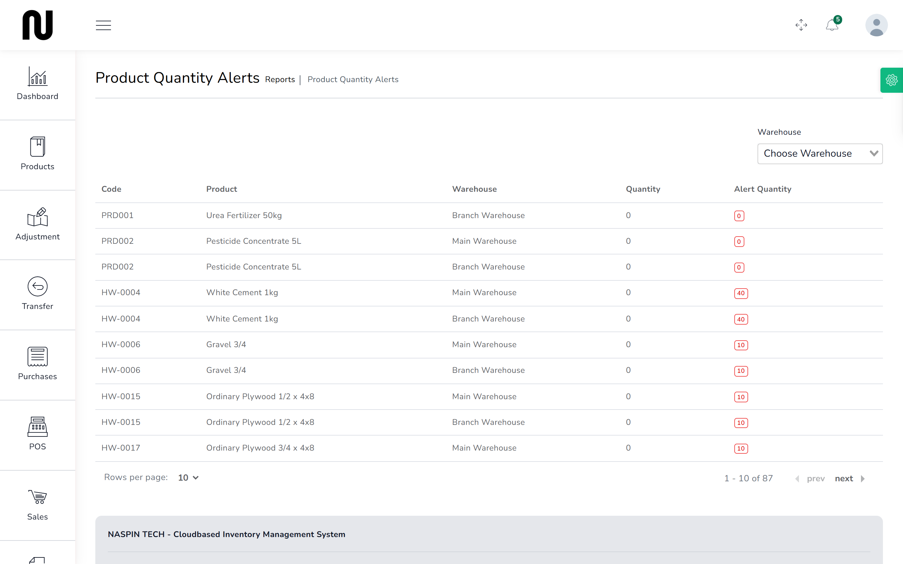

# What to reorder

This is the screen to open before ringing a supplier. It lists what has run down, how far below
its alert level it is, and roughly what restocking will cost.

## Steps

1. From the menu, choose **Reports**, then **Reorder Suggestions**.
   

2. Use the **Warehouse** box to look at one branch, or leave it on all warehouses for the whole
   shop.

3. Read the two figures at the top:
   - **Products To Reorder** — how many lines need attention.
   - **Estimated Cost** — roughly what it costs to bring them all back up, at current cost
     prices.

4. Work down the table. For each line:

   | Column | What it tells you |
   |---|---|
   | **In Stock** | what is on the shelf now, shown in red when it is zero |
   | **Alert Quantity** | the level this product should not drop below |
   | **Shortfall** | how far under that level it is |
   | **Suggested Qty** | how much to order, based on the product's reorder quantity |
   | **Preferred Supplier** | who normally supplies it, where that has been set |

5. Order what you need. See [Order stock](07-order-stock.md).

## On a phone

Nothing is dropped on a phone. All nine columns are still there — the table is wider than the
screen, so you drag the table itself sideways to reach **Suggested Qty** and **Preferred
Supplier** out to the right. The page behind it does not move; only the table does.

The two totals at the top sit above the table, so **Products To Reorder** and **Estimated
Cost** are readable without any dragging.

## What happens next

Nothing on this screen changes stock. It is a list to act on, not a document.

Once goods are booked in, lines drop off as they come back above their alert level.

## Making the suggestions useful

The suggestions are only as good as the levels set on each product:

- **Alert quantity** is the level that puts a product on this list. Set it to roughly what you
  sell between deliveries, so you are warned while there is still time to order.
- **Reorder quantity** is what **Suggested Qty** is based on.
- **Preferred supplier** fills the last column. Without it you are looking the supplier up
  every time.

All three are on the product's own record. See [Add a product](17-add-a-product.md).

A product with its alert quantity left at 0 never appears here, however empty it gets. If
something ran out and this screen never warned you, that is the first thing to check.

## Related

**Reports** → **Product Quantity Alerts** shows the same shortages per warehouse, which is more
use when deciding whether to transfer stock between branches rather than buy more.

See [Move stock to the branch](11-move-stock.md).
