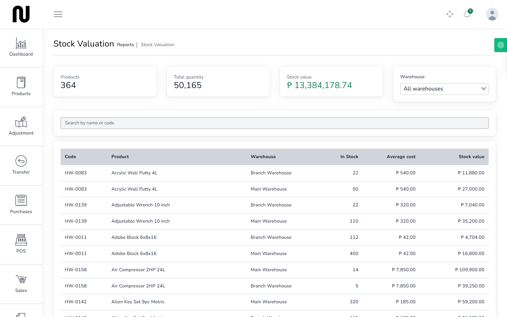
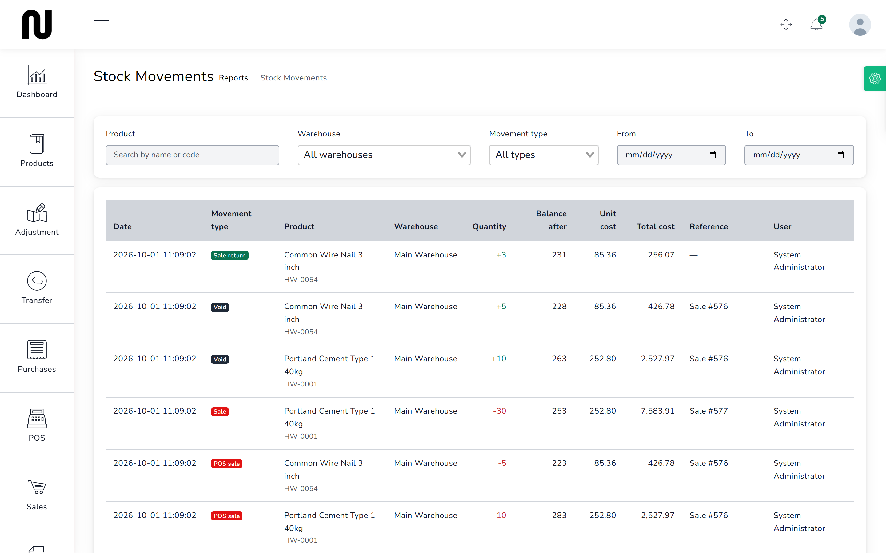

# What the stock is worth

What the shop is holding, and what it cost. This is the figure for insurance, for the accountant,
and for knowing how much money is sitting on the shelves rather than in the bank.

## Steps

1. From the menu, choose **Reports**, then **Stock Valuation**.
   

2. Read the three figures at the top:
   - **Products** — how many product-and-warehouse lines are holding stock.
   - **Total quantity** — total units, across everything.
   - **Stock value** — what it all cost, at average cost.

3. Use the **Warehouse** box to see one branch on its own.
   Each branch is valued separately, which is what you need when they are insured separately or
   when you are deciding where stock should sit.

4. The table lists each product with its **In Stock**, **Average cost** and **Stock value**.

## What the figures mean

**This is cost, not retail.** It is what the shop paid, not what the shop would get. Valuing
stock at selling price would book the profit before anyone has bought anything.

**Average cost** is the weighted average of everything you have bought. If you held 56 bags at
₱249.53 and then bought 120 at ₱252, the average becomes ₱250.44 — and that figure is what the
next sale's margin is worked out against.

So the valuation moves when you buy, not only when you sell. A delivery at a higher price raises
the value of the stock you already had.

## What to look for

**Value concentrated in a few lines.** Power tools and roofing sheets tie up far more money than
nails. If cash is tight, that is where it is.

**Stock that never moves.** Cross this against **Reports** → **Stock Movements**: a line with a
high value and no movements for months is money sitting still.

**A branch holding more than it sells.** Compare the two warehouses. Stock in the wrong place is
as useless as no stock, and moving it costs less than buying more. See
[Move stock to the branch](11-move-stock.md).

## Related reports

| Report | What it answers |
|---|---|
| **Stock Movements** | why a figure changed — every movement with the document behind it |
| **Profit and Loss** | what the shop made over a period |
| **Sales Report** | what sold, and for how much |
