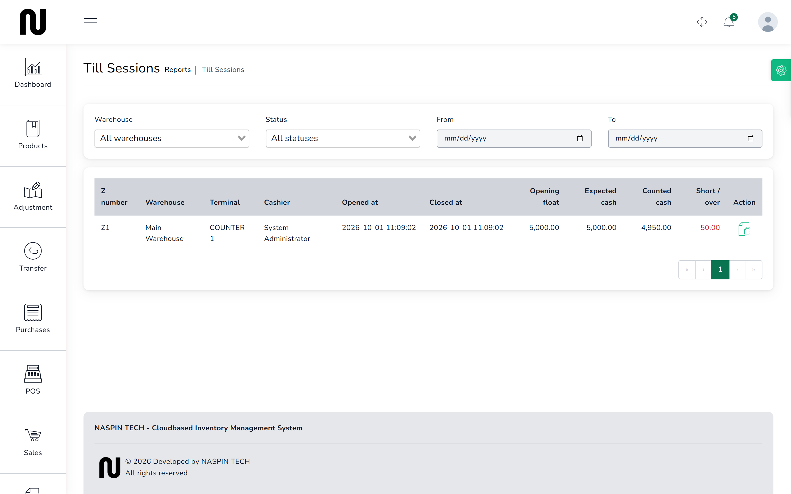
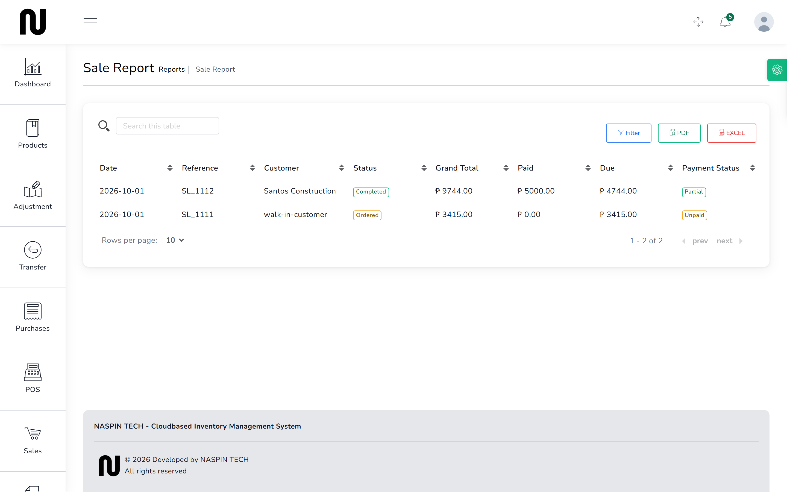

# The day's takings

What was sold, what was in the drawer, and whether the two agree. This is the end-of-day check
and the first place to look when cash is missing.

## Steps

1. From the menu, choose **Reports**, then **Till Sessions**.
   Every shift is listed, newest first.
   

2. Each row is one shift: who opened it, which terminal, when it opened and closed, and the
   money.

3. Open a shift to see its full **Z-reading**.

## Reading a Z-reading

| Line | What it means |
|---|---|
| **Opening float** | the cash the drawer started with |
| **Cash sales** | cash taken during the shift — not GCash or card |
| **Cash in** / **Cash out** | money added or removed without a sale |
| **Expected cash** | what should have been in the drawer |
| **Counted cash** | what the cashier actually counted |
| **Short / over** | the difference between the two |

It also carries the number of invoices, the first and last invoice numbers, the VAT split, and
any voided sales.

**The invoice range matters.** The BIR expects an unbroken run of invoice numbers. A voided sale
still appears in the range rather than leaving a gap, which is why cancelling a sale keeps the
invoice. See [Cancel a sale](05-cancel-a-sale.md).

## What a difference means

**Short** means less cash than expected; **over** means more. Both are recorded, not hidden.

The usual causes, in rough order of likelihood:

1. Change given wrong.
2. A cash sale rung up as GCash, or the other way round.
3. Money taken from the drawer without using **Cash out** — paying a delivery driver, buying
   lunch.
4. A sale rung up at the wrong price.

A drawer that balances to the centavo every single day deserves a second look rather than
praise. It usually means somebody is typing the expected figure into **Counted cash** instead of
counting the drawer.

## The rest of the day's figures

| Report | What it answers |
|---|---|
| **Sales Report** | what sold, in what quantity, for how much |
| **Profit and Loss** | income less cost of goods and expenses, over a period |
| **Payments Sale** | what came in, split by payment method |

The **Dashboard** shows the headline figures for the current week without opening a report at
all.
