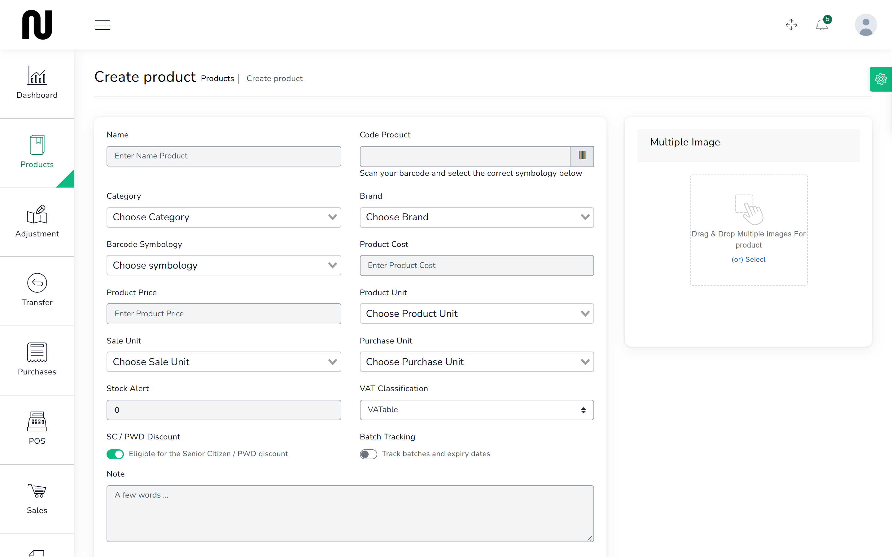
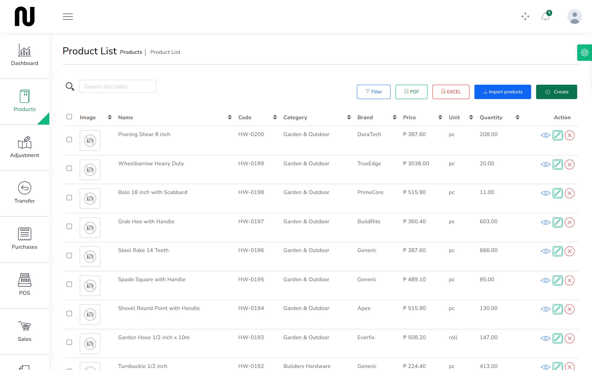
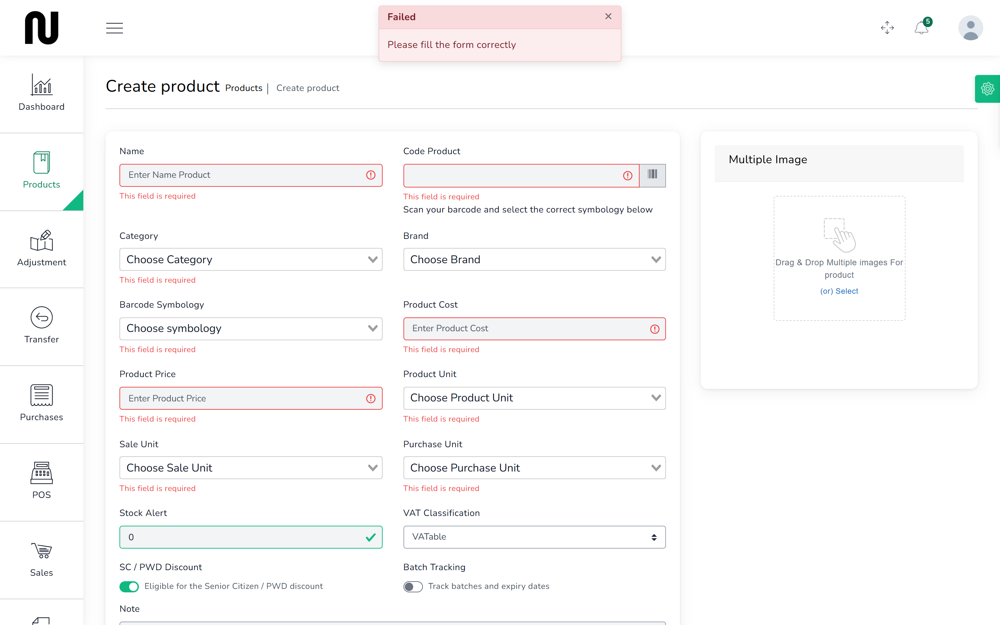

# Add a product

A new line arrives that the shop has never stocked. Putting it in the catalogue correctly now
saves correcting every sale of it later.

**Before you start:** decide the code you will use. The shop's hardware lines run **HW-0001**
upward. Keep to a pattern — codes are what people scan and search by.

## Steps

1. From the menu, choose **Products**, then **Create Product**.
   

2. Enter the **Name** as a person at the counter would say it, including the size.
   "Portland Cement Type 1 40kg" is findable. "Cement" is not.

3. Enter the **Code**, or generate one.

4. Choose the **Category** and **Brand**.
   Categories are what the reports group by, so putting a line in the wrong one hides it.

5. Choose the **Unit**.
   This is how the item is sold — bag, sheet, length, kilogram, piece, roll. Getting it wrong
   makes every document about that product nonsense: cement by the piece, wire by the bag.

6. Enter the **Cost** — what the supplier charges you.
   This is the starting figure. It is recalculated as an average every time you book in a
   delivery.

7. Enter the **Price** — what the customer pays, including VAT.

8. Set the tax method so the price is treated as **VAT-inclusive**.
   This is the one to get right. Philippine retail prices are displayed with VAT already in
   them, so the label is what the customer pays and the VAT is worked back out of it. If the
   product is set up as VAT-exclusive instead, a ₱276 bag of cement rings up at ₱309 and the
   receipt is wrong.

9. Set the **Stock Alert** quantity — the level at which it should appear on the reorder list.
   Roughly what you sell between deliveries. Leaving it at 0 means it never warns you.

10. Press **Submit**.

## What happens next

The product appears in the catalogue and gets a stock record in **every** warehouse, starting at
zero. It is immediately findable at the counter, though with nothing to sell until stock arrives.

To put stock on it, either book in a delivery ([Order stock](07-order-stock.md), then
[Book in a delivery](09-book-in-a-delivery.md)) or, for opening stock you already have, make an
**Addition** adjustment ([Write off damage](12-write-off-damage.md)).

## If it does not work

| You see | It means | Do this |
|---|---|---|
| **Please fill the form correctly** | the red box at the top of the screen, saying only that something is wrong | the boxes at fault are outlined in red further down, each with its own message |
| **This field is required** | a required box is blank | the highlighted boxes are name, code, category, unit, cost and price |
| **This code already used. Generate Now** | another product already has that code | use a different code, or press to generate one |
| the price at the counter is higher than you typed | the product is set VAT-exclusive | edit it and set the price as VAT-inclusive |
| it does not appear at the counter | the warehouse holds none of it yet | that is expected; stock it first |
