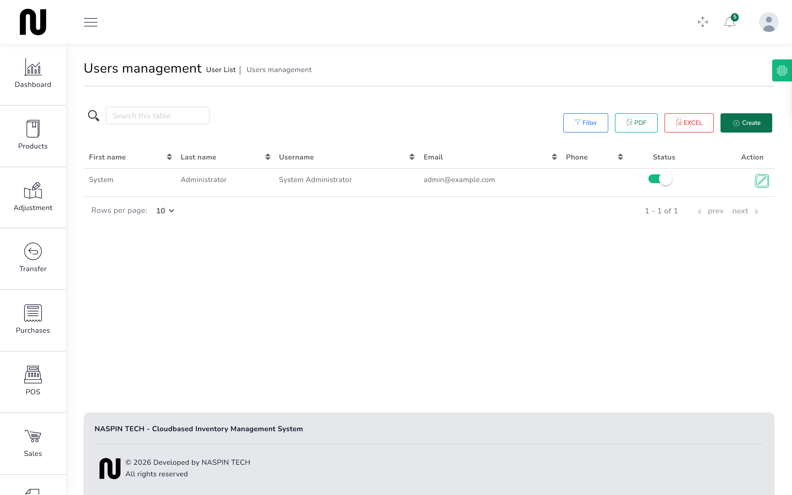
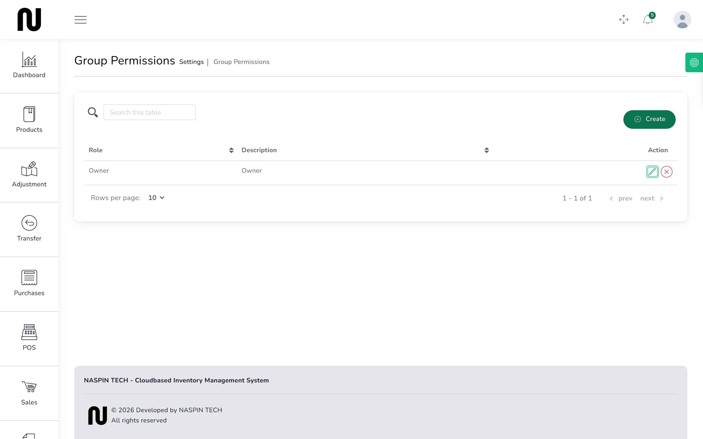

# Add a staff account

Everyone who uses CIMS should have their own sign-in. Shared logins make the Z-reading useless:
when a drawer is short, "who was on the till" has to have an answer.

**Before you start:** decide what this person should be able to reach. See *Deciding what each
person sees* below.

## Steps

1. From the menu, choose **People**, then **Users**.
   

2. Press to create a user.

3. Enter their name, **Username**, **Email** and phone.
   The email is what they sign in with, so it must be one they can actually get to.

4. Set a password.

   It must be at least 8 characters and contain an uppercase and a lowercase letter. Give it to
   them directly and have them change it — do not send it by text.

5. Choose their **Role**.

6. Choose the warehouses they work at, or mark them as covering all.

7. Press to save.
   They can sign in straight away.

## Deciding what each person sees

The shop currently has one role, **Owner**, which can reach everything — the till, the stock,
the cost prices, the reports and the settings.

That is fine for a shop run by one family. It is not fine once you have counter staff who should
not see what the shop pays for cement.

CIMS controls this through roles. **Settings** → **Permissions** is where a role is created and
what it can reach is ticked.

Two roles worth creating:

**Cashier** — the counter and nothing else. Can open a till, sell, hold baskets and close the
drawer. Cannot see cost prices, cannot change products, cannot reach reports.

**Stockman** — purchases, goods receipts, transfers, adjustments and counts. Cannot sell and
cannot reach the money reports.

This guide was written on a shop with only the Owner role, so what a restricted account actually
looks like on screen is not shown here. Create the role, sign in as that person once, and check
the menu shows only what you intended.

## What happens next

Their sign-ins are recorded, and anything they do carries their name — the sale, the adjustment,
the approval, the drawer count.

To stop someone using CIMS, mark their account inactive rather than deleting it. Deleting an
account that has documents against it would leave those documents with nobody's name on them.

## If it does not work

| You see | It means | Do this |
|---|---|---|
| **This Email already taken.** | an account already uses that email | use another, or reactivate the existing account |
| **It must be at least 8 characters. It needs an uppercase letter. It needs a lowercase letter.** | the password is too weak | use a longer one with both cases |
| **This field is required** | a required box is blank | fill the highlighted boxes |
| they sign in but see nothing | their role has no permissions ticked | **Settings** → **Permissions**, and grant what the job needs |
