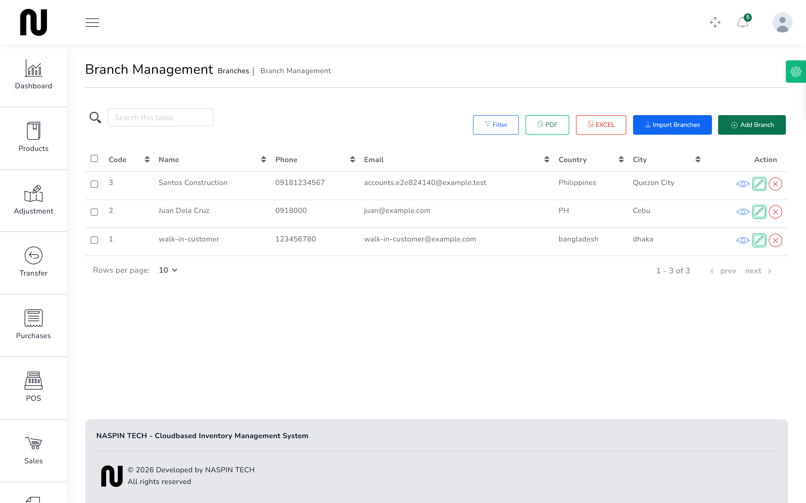
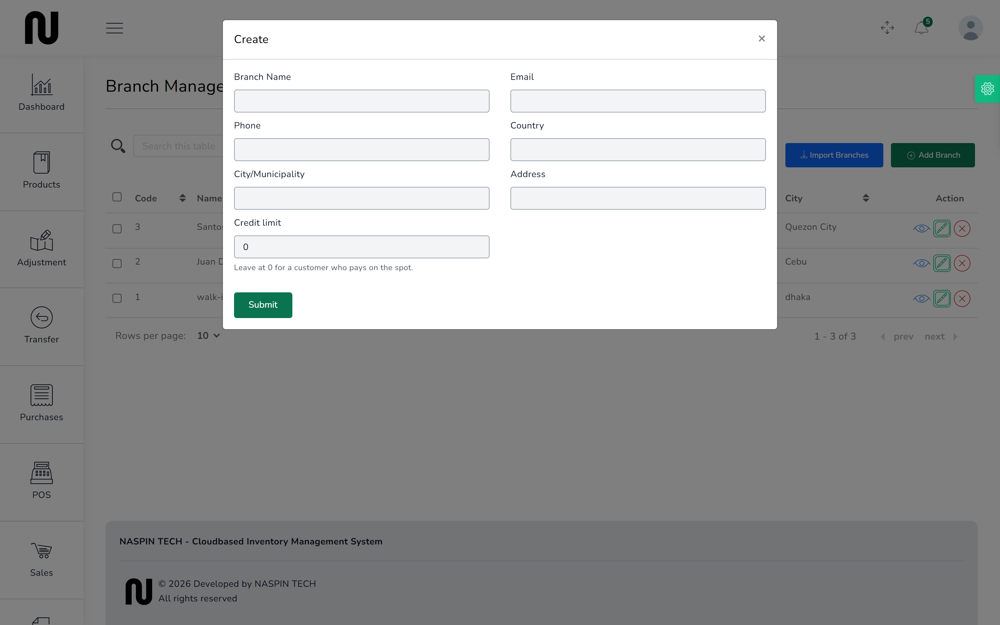
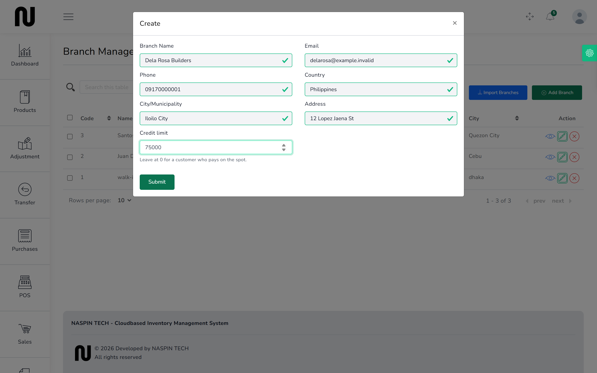
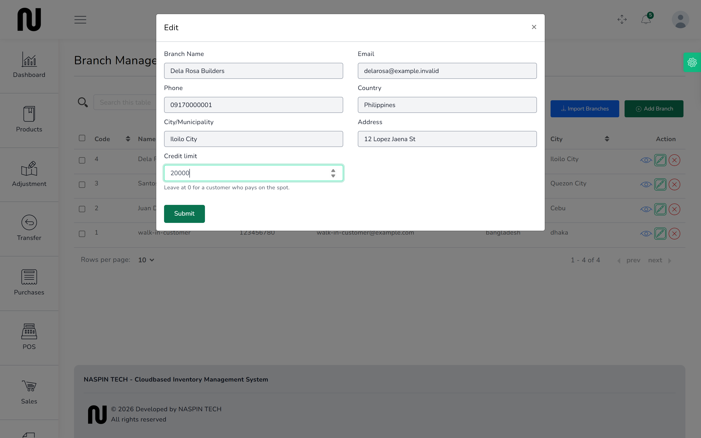

# Add a customer

Most sales are to whoever walks in, and those go through **walk-in-customer** without anyone
typing a name. You only add a customer when you need to know who they are later: a contractor
who buys on account, or anyone whose unpaid balance you have to chase.

**Before you start:** decide whether they may owe you money, and how much. That is the
**Credit limit**, and it is the one box on this form that changes what happens at the counter.

## The screen is called Branches

In the menu this is **People** → **Branches**, and the screen is headed **Branch Management**.
The boxes say **Branch Name**, **Branch Code**.

Everywhere else in CIMS the same record is called a **Customer** — on the counter screen, on a
quotation, on a sale, on a return. It is one thing with two names. Nothing is wrong; the words
just do not match.

## Steps

1. From the menu, choose **People**, then **Branches**.

2. Press **Add Branch**.
   A box headed **Create** opens.
   

3. Fill in **Branch Name**, **Email**, **Phone**, **Country**, **City/Municipality** and
   **Address**. All of them are required.

4. Set the **Credit limit**.

   This is the most you will let them owe at any moment. A contractor on ₱75,000 can run up to
   that much unpaid before the counter stops them.

   **Leave it at 0 for anyone who pays on the spot.** 0 does not mean "no credit" — it means
   *no limit is checked at all*. The box says so underneath, but it is the opposite of what the
   number looks like, so it is worth reading twice.

5. Press **Submit**.
   

## Changing a limit later

Press the pencil on their row. The box opens with the limit they already have, and saving
replaces it.

Lowering a limit below what they already owe does not undo anything. The sales already made
stand; they simply cannot buy more on account until they pay some of it off.

## What happens next

They can now be chosen on a quotation, at the counter, and on a sale return.

Their balance builds up as unpaid sales, and you can see it on
[What customers owe](23-what-customers-owe.md). Once it reaches the limit, the next sale on
account is refused — see [Sell on account](22-sell-on-account.md).

## If it does not work

| You see | It means | Do this |
|---|---|---|
| **This field is required** | one of the boxes is empty | every box except Credit limit must be filled |
| **This Email already taken.** | a customer already uses that email | use another, or find the existing record |
| nothing happens when you press Submit | a box further up the form is empty and outlined in red | scroll up the box and look for red |

A customer cannot be deleted once they have sales against them. That is deliberate — deleting
them would leave those invoices with nobody's name on them.
