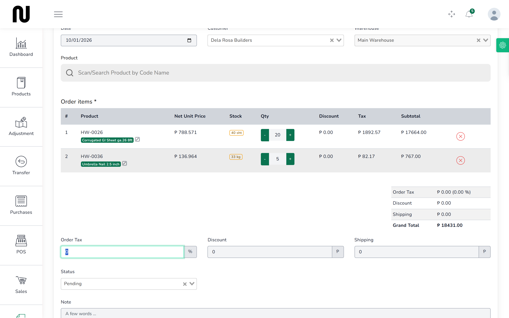
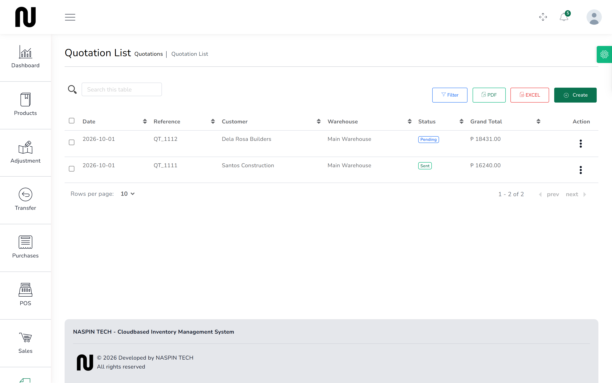

# Quote a job

A contractor asks what a job's materials will cost. You put the list together, print it, and
they go away to think about it. Nothing leaves the shelf and nothing is owed.

A quotation is a price on paper. It is not an order, and it does not reserve stock — if someone
else buys the last twenty sheets this afternoon, the quote still says twenty.

## Steps

1. From the menu, choose **Quotations**, then press **Create**.

2. Choose the **Customer** and the **Warehouse**.
   The warehouse decides which stock figures you are quoting against.

3. Find each item in **Scan/Search Product by Code Name** and press it to add a line.

4. Set the **Qty** on each line.
   

5. Press **Submit**.
   You get **Quotation Created successfully** and land back on the list.

## Read the price off Subtotal, not Net Unit Price

**Net Unit Price** is shown without VAT, to three decimal places — a sheet of GI roofing shows
as ₱ 788.571.

That is not the price the customer pays. The **Subtotal** column is, and so is **Grand Total**
at the bottom. Quote from those.

If you read the quote to a customer off the Net Unit Price column you will undercharge them by
the VAT, on every line.

## What happens next

The quotation appears on the **Quotation List** with a reference beginning **QT_**.

Nothing has moved. No stock, no money, no balance on the customer's account.

The three dots at the end of the row give you **Show**, **Edit**, **Create Sale**, **PDF**,
**Email** and **Delete**. **PDF** is what you hand or send to the contractor.

**Email does not work.** The shop's outgoing mail has never been set up, so it fails the same
way the password reset does — see
[When something goes wrong](when-something-goes-wrong.md). Use **PDF** and send it yourself.

When they come back to buy, see
[Turn a quote into a sale](21-turn-a-quote-into-a-sale.md).

## Statuses

A quotation shows **Pending** or **Sent**. Neither does anything on its own — they are notes to
yourselves about whether the customer has seen it.

## If it does not work

| You see | It means | Do this |
|---|---|---|
| **This field is required** | the customer or warehouse is not chosen | both are needed before you can submit |
| the product search finds nothing | no warehouse is chosen yet | choose the warehouse first; the search looks within it |
| **Please fill the form correctly** | something is empty, and this message does not say what | look for boxes outlined in red |
| the quote has no lines | a product was searched but never pressed | press the product in the list that drops down |
