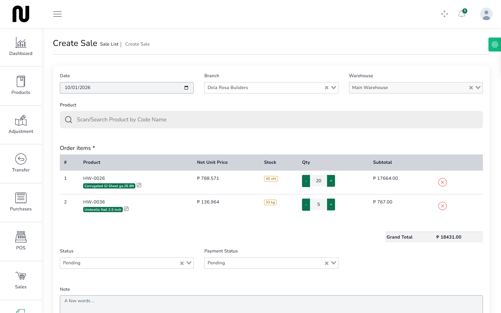
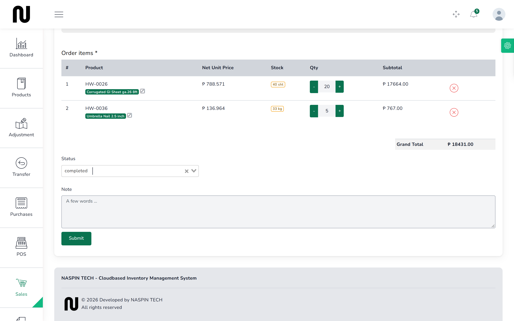
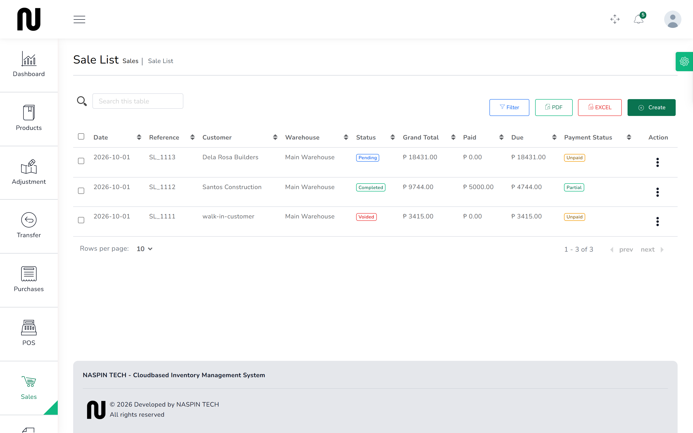

# Turn a quote into a sale

The contractor comes back with the quote and wants the materials. CIMS can make the sale from
the quotation, so nobody retypes twenty lines and nobody mistypes one.

**Read the warning on this page before you use it.** Converting a quote invoices the customer
but does **not** take the goods off the shelf. There is a second step, and if you miss it the
stock figures are wrong from that moment on.

## Steps

1. From the menu, choose **Quotations**.

2. Find the quotation. Press the three dots at the end of its row and choose **Create Sale**.

3. The **Create Sale** screen opens with every line and the total already filled in from the
   quote.
   

4. Check the figures against the quote, then press **Submit**.
   You land on the **Sale List**.

## The goods are still on the shelf

The sale this makes is **pending** and **unpaid**, and **no stock has moved**.

That is real: book in a sale this way, hand the contractor twenty sheets of roofing, and CIMS
still believes those twenty sheets are in the warehouse. The next person to check stock, or to
sell from it, will be working from a figure that is wrong.

**You must finish the sale.**

5. On the **Sale List**, find the sale. Press the three dots and choose **Edit**.

6. Change **Status** to **completed**.
   

7. Press **Submit**. You get **Sale Updated successfully**.

Only now does the stock come off. Twenty sheets leave the warehouse at that moment, not before.

## What happens next

The sale is on the **Sales** list with a reference beginning **SL_**.

If the customer has not paid, the amount sits against their name as money owed. See
[What customers owe](23-what-customers-owe.md).

The quotation stays on its own list. It is not deleted and not marked used, so **nothing stops
anyone converting the same quote twice** — which would invoice the contractor for the same
materials again. Check the Sales list before converting, especially if someone else may have
dealt with it.

## Statuses on a sale

| Status | What it does |
|---|---|
| **completed** | the goods have gone; stock comes off |
| **Pending** | nothing has moved yet |
| **ordered** | nothing has moved yet |

Only **completed** moves stock. The capitalisation is inconsistent on screen; that is how it
appears.

## If it does not work

| You see | It means | Do this |
|---|---|---|
| **Create Sale** is not in the row menu | the row menu is shut | press the three dots at the end of the row first |
| the sale saved but stock did not change | the sale is still **Pending** | edit it and set **Status** to **completed** |
| **Insufficient stock for the selected product and warehouse.** | the warehouse no longer holds what was quoted | a quote does not reserve stock; check what is actually there |
| **This sale would take {customer} to {amount}, over their credit limit of {limit}.** | the customer has reached their limit | see [Sell on account](22-sell-on-account.md) |
