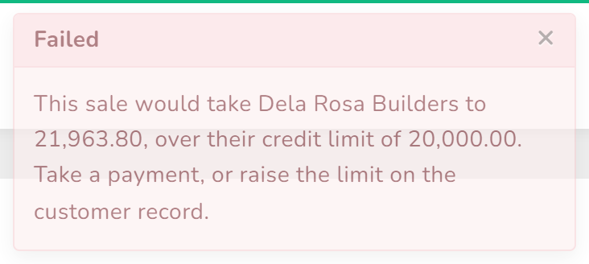

# Sell on account

A contractor takes materials today and settles at the end of the month. The sale is recorded in
full, the goods leave, and the amount sits against their name until they pay.

This only works for a customer who exists as a record. Walk-in sales cannot go on account —
there is nobody to chase.

## Steps

1. From the menu, choose **Sales**, then press **Create**.

2. Choose the **Branch** (the customer) and the **Warehouse**.
   This screen says **Branch** where the quotation screen says **Customer**. Same thing.

3. Add the products and set the quantities.

4. Set **Status** to **completed**, so the goods actually leave the shelf.

5. **Choose a Payment Status — do not leave it alone.**

   | Choice | Means |
   |---|---|
   | **Paid** | they are paying the whole amount now |
   | **partial** | they are paying some of it now |
   | **Pending** | they are paying nothing now — this is selling on account |

   You must open the box and pick, even if the one you want is already showing. Until you do,
   the sale will not save and the reason given is unhelpful.

6. Press **Submit**.

## What happens next

The goods come off the shelf and the sale appears on the **Sales** list as **Unpaid**, with the
full amount in the **Due** column.

The customer's balance goes up by that amount. You can see every customer's balance on
[What customers owe](23-what-customers-owe.md).

When they pay, record it against the invoice rather than as a new sale — otherwise the stock
goes off the shelf twice.

## When they have reached their limit

If the sale would take them past the **Credit limit** on their record, it is refused and
nothing is saved:

The message tells you the figure the sale would take them to, and the limit it would pass. You
have three honest choices:

- **Take a payment first**, which brings the balance down, then make the sale.
- **Sell it to them for cash** instead of on account.
- **Raise the limit** on their record, if the shop is willing to carry more — see
  [Add a customer](19-add-a-customer.md).

What you should not do is raise the limit just to get the sale through. The limit is the only
thing standing between a contractor and an unpayable bill.

A customer whose **Credit limit** is **0** is never checked at all. Nothing will stop a sale to
them, however much they already owe.

## If it does not work

| You see | It means | Do this |
|---|---|---|
| **This sale would take {customer} to {amount}, over their credit limit of {limit}. Take a payment, or raise the limit on the customer record.** | the customer has reached their limit | take a payment, sell for cash, or raise the limit |
| **The amount paid cannot be more than the order total of {amount}.** | the amount being paid is above the sale total | enter what they owe; put the cash handed over in **Received Amount** |
| **Insufficient stock for the selected product and warehouse.** | this warehouse does not hold that many | check the figure, or sell from the other warehouse |
| the sale will not save and the message does not say why | **Payment Status** was never actively chosen | open the **Payment Status** box and pick, even if it already shows what you want |
| stock did not change after the sale saved | the sale is **Pending**, not **completed** | edit the sale and set **Status** to **completed** |
