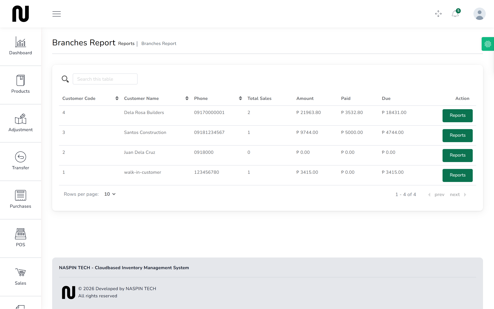
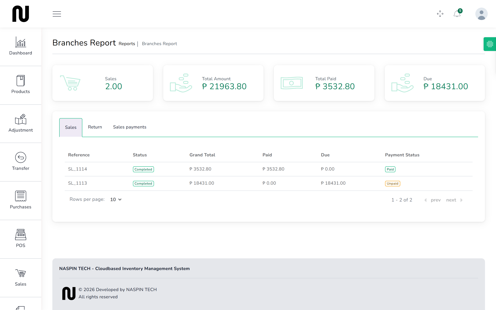
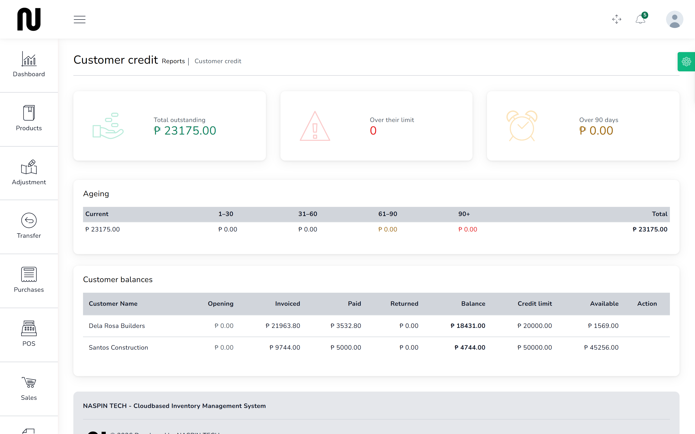

# What customers owe

Two screens answer this. One lists every customer with a balance; the other opens a single
customer's account so you can see which invoices make it up.

Open these before extending more credit, and before ringing anyone about money.

## Everyone, at a glance

From the menu, choose **Reports**, then **Branches Report**.

| Column | What it tells you |
|---|---|
| **Total Sales** | how many invoices they have had |
| **Amount** | what those invoices came to in total |
| **Paid** | how much of it has been settled |
| **Due** | what is still owed — the number that matters |

The screen is titled **Branches Report** and its columns say **Customer**. Same records, two
names, as everywhere else.

## One customer's account

Press **Reports** at the end of a customer's row.

The totals sit at the top, and underneath are three tabs:

- **Sales** — every invoice, with **Paid**, **Due** and **Payment Status** on each
- **Sales Return** — anything they brought back
- **Sales payments** — each payment received, and when

This is the screen to have open when a contractor queries a bill. It shows the individual
invoices rather than one lump, so you can say which one is unpaid.

## Ageing: how late is it

From the menu, choose **Reports**, then **Customer credit**.

This one adds the question the other two do not answer — *how long* it has been owed:

| Column | Meaning |
|---|---|
| **Current** | not yet overdue |
| **1–30**, **31–60**, **61–90**, **90+** | days the money has been outstanding |
| **Balance** | what they owe in total |
| **Credit limit** | the ceiling on their record |
| **Available** | what they can still spend before being refused |

A balance sitting in **90+** is the one to act on. A customer whose **Available** is near zero
is about to be refused at the counter, which is better discovered here than in front of them.

**Credit limit** shows **NoLimit** when it is 0. That customer is never checked, whatever they
owe.

## What these screens do not do

None of them chases anybody. Nothing is sent, no reminder goes out, and no statement is emailed
— the shop's outgoing mail has never been set up. These are screens to read before you pick up
the phone.

## If it does not work

| You see | It means | Do this |
|---|---|---|
| a customer is missing | they have no sales yet | customers only appear once they have been invoiced |
| **Due** looks too high | a sale was recorded as **Pending** payment and never settled | open their statement and find the unpaid invoice |
| **Due** looks too low | a sale is still **Pending** status, so it has not counted yet | check the **Sales** list for sales that were never completed |
| **NoLimit** under Credit limit | their limit is 0 | 0 means no limit is enforced; set one on their record if you want one |
