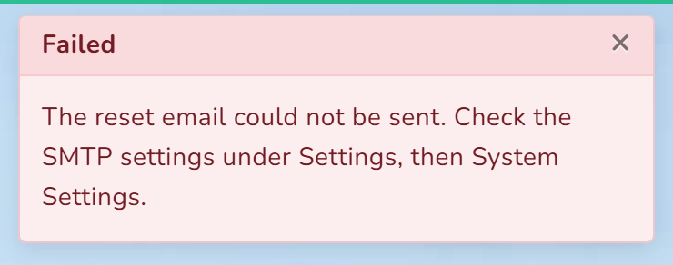
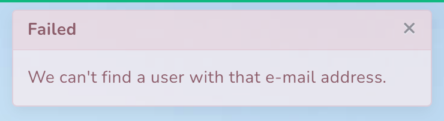

# When something goes wrong

Every message below was produced by actually causing the problem on a working shop. They are
printed word for word as they appear on screen.

Find your message in the first column. Messages with **{braces}** fill in a real figure, name or
date when you see them.

They are listed alphabetically, because you are looking at a message rather than thinking about
which part of the system produced it.

| You see | It means | Do this |
|---|---|---|
| **Choose Warehouse** | you pressed **Pay Now** before choosing a warehouse at the counter | choose the warehouse in the second box down, then ring the sale up again |
| **Everything on this order has been received, so there is nothing to close.** | you tried to close an order short, but it is already complete | no action needed; check its status on the **Purchases** list |
| **Insufficient stock for the selected product and warehouse.** | this warehouse does not hold that many, even if another branch does | check the stock figure; reduce the quantity, sell from the other branch, or transfer stock in |
| **It must be at least 8 characters. It needs an uppercase letter. It needs a lowercase letter.** | the password for a staff account is too weak | use a longer password with both upper and lower case |
| **Only {amount} is still due on this sale.** | you are taking more than the invoice balance | enter the outstanding amount; if the customer is paying more, the rest is a payment on another invoice |
| **Only {amount} is still owed on this purchase.** | you are paying a supplier more than the balance | enter the outstanding amount |
| **Open the till before selling. No drawer is open for you at this warehouse.** | there is no open drawer for you here | see [Open the till](02-open-the-till.md) |
| **The reset email could not be sent. Check the SMTP settings under Settings, then System Settings.** | the shop's outgoing mail is not set up, so no reset email can leave | see *A reset email that never arrives* below |
| **Please fill the form correctly** | something on the form is wrong or missing, and this message does not say what | scroll the form; the boxes at fault are outlined in red with their own message underneath |
| **That sale has already been voided.** | somebody voided this invoice already | check the status on the **Sales** list; no further action is needed |
| **That sale was not made today. Use a sale return instead.** | voiding only applies to the current day | handle it as a sale return |
| **That shift has already been counted down. Use a sale return instead.** | the drawer was closed after the sale | the drawer is settled; handle it as a return instead |
| **The amount paid cannot be more than the order total of {amount}.** | the tendered figure is above the sale total | put what the customer owes in **Paying Amount**, and what they handed over in **Received Amount** |
| **This count is already completed.** | the stock count is finished | corrections have been posted; make an adjustment if you need to change something |
| **This count is {status} and can no longer be edited.** | the count is finished or cancelled | start a new count, or make an adjustment |
| **This drawer already has a session open. Close it before opening another.** | this terminal already has an open drawer | press the amount at the top left to see it, and close it first |
| **This Email already taken.** | a staff account already uses that email | use a different email, or reactivate the existing account |
| **This code already used. Generate Now** | another product has that code | use a different code, or press to generate one |
| **This field is required** | a box that must be filled is empty | the box is outlined in red; fill it and submit again |
| **This order was already closed short on {date}.** | somebody closed this order short already | check the **Purchases** list for the reason recorded |
| **This order was closed short on {date} ({reason}). Raise a new order for anything that still arrives.** | the goods turned up after the order was closed | raise a new order for what arrived; the closed one stays closed |
| **This purchase is awaiting approval and cannot be received yet.** | the order has not been signed off | see [Approve an order](08-approve-an-order.md) |
| **This purchase is not awaiting approval (it is {status}).** | it has already been approved or rejected | no action needed |
| **This purchase was rejected and cannot be received.** | the order was turned down | raise a new order if the goods are genuinely wanted |
| **This sale is already paid in full.** | the invoice has nothing outstanding | check the **Sales** list; no payment is due |
| **This sale would take {customer} to {amount}, over their credit limit of {limit}. Take a payment, or raise the limit on the customer record.** | a credit customer has reached their limit | take a payment on their account, sell for cash, or raise the limit — see [Sell on account](22-sell-on-account.md) |
| **Invalid Data !!** | a sale was refused and the screen did not say why | the usual cause is that **Payment Status** was never actively chosen on **Create Sale**; open that box and pick, even if it already shows what you want |
| **We can't find a user with that e-mail address.** | you asked for a password reset for an address that has no account | check the spelling; if it is right, that person has no CIMS account yet |

## A reset email that never arrives

**Forgot Password ?** on the sign-in screen cannot send anything yet. The shop's outgoing mail
settings are still the demonstration ones that came with the system, so the message has nowhere
to go. This is what you get instead, at the top of the screen:

It takes up to half a minute to appear, because the system waits for the mail server to answer
before giving up. The screen looks stuck in the meantime. Press once and wait.

Do not wait for an email. Ask whoever looks after the shop's accounts to set you a new password
— see [Add a staff account](18-add-a-staff-account.md).

Making it work is a job for whoever set CIMS up: the outgoing mail server, port and sign-in go
in **Settings** → **System Settings**, under **SMTP Configuration**. Two things to know before
relying on it:

- The reset link in the email is built from the address CIMS publishes itself at, which is
  currently the counter PC's own address. A link opened on a phone will not work. That address
  has to change before reset emails are useful away from the counter.
- Anyone who can reach the sign-in screen can find out whether an email address has an account,
  because the screen answers this when it does not:

  

  That is a different message from the one above, and the difference tells an outsider which
  addresses belong to staff. Worth raising with whoever maintains CIMS.

## Things that look broken but are not

**A screen sits blank for a few seconds.** Reports and the counter product grid take about three
to six seconds to fill. There is no message while they load, so a slow screen looks the same as a
stuck one. Wait before pressing again — pressing twice can raise two documents.

**A purchase order stays open after the delivery arrived.** If anything was rejected or short,
the order is genuinely not complete. See [Close a short order](10-close-a-short-order.md).

**A sale was made from a quotation but the stock has not changed.** That is how it works: a
converted quote is **Pending** until someone sets it to **completed**. Until then the goods are
still on the shelf as far as CIMS is concerned, even if the customer has driven off with them.
See [Turn a quote into a sale](21-turn-a-quote-into-a-sale.md).

**The same reference appears on two different lists.** A customer return and a supplier return
both number from **RT_**, separately — so **RT_1111** can be one of each. When quoting a
reference to anyone, say which list it came from.

**A voided sale is still on the list.** That is deliberate. The invoice and its number stay, so
the run of invoice numbers is unbroken for the BIR.

**A held basket did not reserve the stock.** Holding parks the basket; it does not take the goods
off the shelf. If the stock sells meanwhile, you are told when you take payment.

**The product is in the catalogue but not at the counter.** The counter only shows what that
warehouse holds. Check the warehouse box, and whether the product has any stock yet.

## When none of this helps

Note three things before asking for help:

1. **The exact message**, word for word, or a photograph of the screen.
2. **What you were doing** — which screen, and what you pressed.
3. **The reference** of the document, if there is one: **SL_** for a sale, **PR_** for a
   purchase, **GRN_** for a receipt, **TR_** for a transfer, **AD_** for an adjustment,
   **SC_** for a count.

A reference lets anyone find the exact record. Without it, the first ten minutes go on working
out which one you meant.
